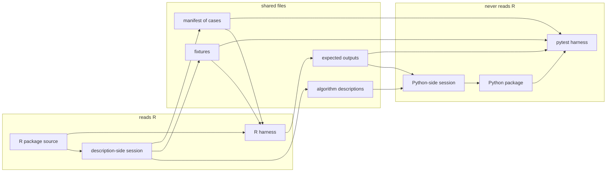
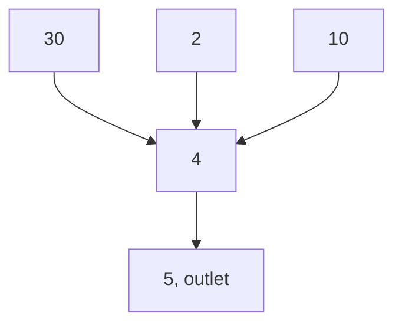
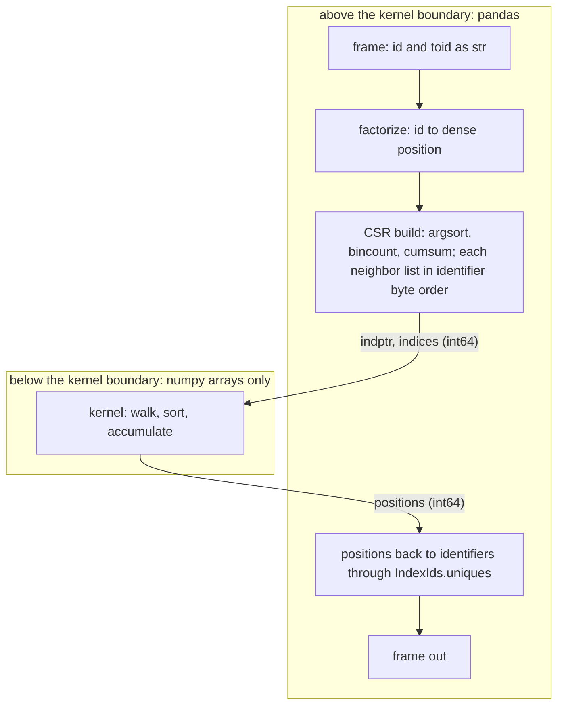
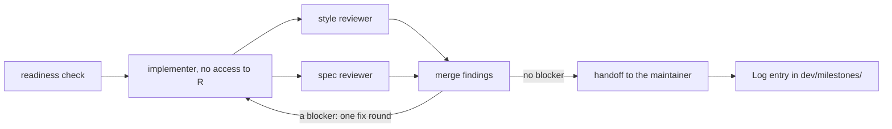

# Fixture architecture of the hydroloom Python port

hydroloom is an R package for working with hydrologic geospatial fabrics, or hydrofabrics: tables of river flowlines (lines that represent segments of flowing water) and catchments (the land that drains directly to a flowline), with the connections between them, that describe how water moves across the land surface. It provides general hydrologic network functionality for any hydrographic or hydrologic data, such as ordering a network from its headwaters to its outlet, walking it upstream or downstream, and adding the attributes a model reads. A Python package with the same functions is being written beside it, in the same repository.

The two packages share no code. What they share is a set of files under `inst/extdata/conformance/`: small test networks called fixtures, a written description of each function, and the outputs the R package produces for every fixture. A Python function is accepted when it reproduces those outputs, case by case. This document explains that arrangement from the fixtures outward: what they are, how one becomes an expected output, how it constrains the lowest layer of the Python code, and how AI agent sessions were used to build it while keeping the Python independent of the R source.

At the time of writing (November 2026), the R side of the arrangement is in place for the first 15 functions, which the plan calls phase 1, with 452 cases on 158 fixtures. No Python function has been written yet. Everything below describes the contract the Python will be written against. Rules are cited by anchor (S-7, D-4) from `dev/plan/SPEC.md`, and the reasoning behind them by section from `dev/plan/DESIGN.md`.

| If you are | Start with |
| --- | --- |
| a Python developer who may write or review a ported function | [A river network as a table](#a-river-network-as-a-table), and read on through [What binds the Python](#what-binds-the-python) |
| reading about how AI agents were used to port an existing package | [Two sessions and a record](#two-sessions-and-a-record) |
| a hydrologist checking the network conventions | [A river network as a table](#a-river-network-as-a-table), then [Fixtures](#fixtures) and [One case, end to end](#one-case-end-to-end) |

## The arrangement in one picture



The left group reads R. A description-side session (an AI agent session allowed to open the R source) writes each function's algorithm description, its fixtures, and its cases. The R harness then runs the R package on every case and writes the result as an expected output, a GeoPackage layer per case. Expected outputs are generated, never typed (SPEC S-7). R is the only generator until a function reaches parity, passing its cases in both languages; after that, Python may write expectations too, and CI checks that the two agree.

The right group never reads R. A Python-side session writes the Python from the description and the expected outputs alone, and the pytest harness compares what the Python returns with what R returned. The planning documents call this two readings of one written definition (DESIGN §1). When the two implementations disagree and the definition is silent, the definition is what gets fixed.

## A river network as a table

hydroloom represents a network as a table with one row per flowline, or per catchment when the network is made of those. Two columns carry the connections: `id`, the flowline's identifier, and `toid`, the identifier of the flowline it flows into.

| id | toid |
| --- | --- |
| 1 | 3 |
| 2 | 3 |
| 3 | |

Flowlines 1 and 2 meet at a confluence and flow into 3. Flowline 3 is an outlet, the flowline where water leaves the network. hydroloom finds outlets by a rule rather than a value: a flowline is an outlet when its `toid` is not present in the `id` column (SPEC I-4, which calls such a row a terminal, the word the fixture file names use). The empty cell could as well be `0`, `-1`, or the identifier of a flowline outside the table. A headwater is a flowline with nothing upstream of it.

Where a river splits, at a divergence, one downstream flowline is the main path and the others are minor paths. A table records the split in one of two ways: by repeating the `id` of the flowline above it, one row per downstream flowline, or by carrying `fromnode` and `tonode` in place of `toid`, the identifiers of the points at the upstream and downstream ends of each flowline (NHDPlus `FromNode` and `ToNode`). Which branch is the main path is a separate column, `divergence`, coded 1 for the main path and 2 for a minor one as in NHDPlus, or the `upmain` and `downmain` flags on a table that repeats `id`. A network with no divergence is dendritic, or tree-shaped: every flowline has one downstream flowline. hydroloom calls each of these column patterns a representation, and each function's description says which ones it accepts.

Identifiers are opaque. NHDPlusV2 uses integers and 3DHP uses strings. NHDPlus HR uses whole numbers too large for 32 bits, and its `NHDPlusID` arrives as floating point (it is stored as REAL in `nhdplushr.gpkg`). Python reads every identifier as a string on ingest (SPEC I-2); R keeps a 32-bit integer where the values fit and a string otherwise. The harnesses compare identifiers as text, so R's integer `100` and Python's `"100"` are the same identifier. Text comparison breaks on a float identifier, which pandas produces from an integer column with one missing value: `3.0` does not match `3`. One string type in Python also removes an integer ingest path and the re-cast after a pandas operation widens a column, and the kernels described below never need a numeric identifier, since they work on positions (DESIGN §7).

## Fixtures

A fixture fixes one decision about a network in a file small enough to check by hand. Each is a GeoPackage under `inst/extdata/conformance/fixtures/`, built by one script (`make_fixtures.R`) and listed in `fixtures/index.yaml` with its source, its row count, what it exercises, and the SPEC rules it exercises. Of the 158 fixtures, 131 have twelve rows or fewer and 145 carry no geometry, since topology needs only the table. The largest are real networks: a 3DHP extract of the New Hope basin (2,710 flowlines) and an NHDPlus HR subset (2,691). The New Hope basin from NHDPlusV2 (746 flowlines), the network hydroloom already ships, is also the base of copies with shuffled rows, text identifiers, and a feet-based state plane projection.

The fixtures fall into a few families, each pinning a different kind of behavior.

| Family | What it pins | Examples |
| --- | --- | --- |
| boundary (SPEC S-6, I-11) | one flowline, no connections, a repeated row, a missing weight, a zero-length line, an empty name, and zero rows | `single_flowline.gpkg`, `all_terminals.gpkg`, `duplicated_edge.gpkg`, `empty_network.gpkg` |
| tie | an order the algorithm leaves open, decided by identifier | `sort_siblings.gpkg`, `dfs_tie.gpkg` |
| permuted twin | the same network in another row order, which must give the same answer (D-7) | `sort_siblings_permuted.gpkg`, `new_hope_shuffled.gpkg` |
| outlets | many outlets, coastal beside inland, and the `toid` values sources use at an outlet (`0`, `""`, `-1`, missing), all found by the same rule (I-4) | `coastal.gpkg`, `coastal_inland.gpkg`, `outlet_foreign.gpkg` |
| divergence | a split with and without a source `divergence` column (D-9), and codings tolerated with a warning or refused | `divergence_attribute.gpkg`, `divergence_no_attribute.gpkg`, `add_toids_divergence_zero_main.gpkg` |
| non-dendritic | divergences whose branches rejoin, and braided reaches: loops on the map with no cycle in the direction of flow | `return_divergence.gpkg`, `dfs_rejoin.gpkg`, `loop.gpkg` |
| cycle | networks that drain back into themselves, which must be detected (D-8) | `three_cycle.gpkg`, `reciprocal_pair.gpkg`, `self_loop.gpkg` |
| clipped extract | a subset that cuts through a divergence or leaves a `toid` pointing outside the table | `sort_divergence_leaves.gpkg`, `add_toids_divergence_minor_only.gpkg`, `new_hope_ut_8894172.gpkg` |
| real subset | a source's column names, identifier types, and scale | `new_hope.gpkg`, `new_hope_3dhp.gpkg`, `nhdplushr.gpkg` |

A case is one call on one fixture. The manifest, `inst/extdata/conformance/manifest.yaml`, lists 452 of them across the 15 functions: 375 compare a returned value, 70 expect an error, and 7 expect a warning. Its entries are short:

```yaml
- id: sort_network_siblings
  function: sort_network
  fixture: sort_siblings.gpkg
  args: {}
  compare: exact
  order: exact
  supported_by: [r]
  generator: [r]
```

The `id` is the layer name in `expected/sort_network.gpkg` and will be the pytest test id. `order: exact` says row order is part of the answer. `supported_by` and `generator` say which languages pass the case and which write its expectation; the parity table in `conformance/parity.md` is generated from them.

## One case, end to end

`sort_network` orders a network so that reading it from top to bottom goes from upstream to downstream. Its worked example is `sort_siblings.gpkg`, five rows stored in this order:

| id | toid |
| --- | --- |
| 30 | 4 |
| 2 | 4 |
| 10 | 4 |
| 4 | 5 |
| 5 | 0 |



Flowlines 30, 2, and 10 all flow into 4, so any order of the three that precedes 4 is a valid upstream-to-downstream order. Nothing in the network chooses among them. hydroloom 1.3.0 left the choice to input row order: this fixture gave 30, 2, 10, 4, 5, and its permuted twin, the same five rows stored as 5, 2, 4, 10, 30, gave 2, 10, 30, 4, 5. Two copies of one network gave two answers.

SPEC D-4 settles the tie by identifier byte order: the identifiers are compared as text, character by character, so `"10"` precedes `"2"` precedes `"30"`. Byte order works the same on every platform and for integer and string identifiers alike, with no locale setting (D-1). The R package was changed to that rule, with an entry in `NEWS.md` (the R package's changelog), before any Python existed, and the expected layer for both fixtures is now:

| id | toid |
| --- | --- |
| 10 | 4 |
| 2 | 4 |
| 30 | 4 |
| 4 | 5 |
| 5 | 0 |

A third fixture, `sort_siblings_text.gpkg`, carries the string identifiers `B`, `_c`, `a`, and `b`, whose byte order differs from the alphabetical order a locale-aware sort gives. Python's default string comparison is code-point order, which agrees with UTF-8 byte order.

For a hydrologist, the order shares its partial order with NHDPlus hydrologic sequence (`Hydroseq`, a number that decreases downstream; McKay and others, 2012, NHDPlus Version 2: User Guide): sorting a dendritic NHDPlus table by descending `Hydroseq` also puts every flowline after everything upstream of it. The two break ties differently, so they need not agree row for row.

The fixture leaves the code open but not the shape of the order. The order is a depth-first post-order: each sibling, with everything upstream of it, comes before the next sibling and everything upstream of that one (`algorithms/sort_network.md`, Postconditions). A sort on depth with an identifier tie-break interleaves those blocks and does not produce it. A recursive walk and an explicit stack with a countdown per flowline both do, and either passes if it gives this order here and on the other 68 `sort_network` cases.

## From fixture to kernel

In the Python package's design, every graph computation sits below one boundary, the kernel boundary (SPEC K-1). Above it are pandas frames, identifiers, the vocabulary of column names, checks, and errors. Below it are numpy arrays and nothing else: a compressed sparse row (CSR) adjacency in `indptr` and `indices`, attribute arrays, and scalars. Code below the kernel boundary is called a kernel. A kernel never looks up an identifier, reads a column name, or raises a domain error (K-5). `indices` holds dense `int64` positions from 0 to n − 1 and `indptr` holds offsets into it; neither holds an identifier value (K-6). An import-linter contract will hold `hydroloom._kernels` to importing neither pandas, geopandas, shapely, nor `hydroloom._hy`, the module that holds identifiers and the vocabulary (K-9).

`make_index_ids` returns the arrays in `IndexIds`, a frozen dataclass that also holds `uniques` (dense position to identifier) and `mode` (downstream or upstream). It is the one object that crosses the kernel boundary as-is, and `to_scipy()` gives a `scipy.sparse.csr_array` over the same buffers (K-3).



Every tie rule is stated on identifiers, and no kernel can see an identifier. SPEC D-5 closes the gap where the two meet: `make_index_ids` builds the CSR so that every flowline's neighbor list is in identifier byte order. A kernel that visits neighbors in array order then inherits the canonical order without knowing it exists.

The worked example for `make_index_ids` shows the arrays. Three headwaters, 30, 4, and 100, flow into 10, which flows into the outlet 7. With positions assigned in order of first appearance, as `pandas.factorize` does, the upstream (`"from"`) index is:

```text
uniques = ["30", "4", "100", "10", "7"]   # dense position -> identifier
indptr  = [0, 0, 0, 0, 3, 4]              # neighbors of i are indices[indptr[i]:indptr[i+1]]
indices = [2, 0, 1, 3]                    # 10 <- "100", "30", "4";  7 <- "10"
```

Numeric order would list 10's upstream flowlines as 4, 30, 100, and hydroloom 1.3.0 listed them in input row order. The expected output does not store `indptr` or `indices`, since dense positions are the implementation's choice. It stores a long table with one row per connection, and `position` records the order within each list. The case runs with `mode = "both"`, so the layer also holds four `"to"` rows; the four `"from"` rows are:

| mode | id | position | neighbor |
| --- | --- | --- | --- |
| from | 10 | 0 | 100 |
| from | 10 | 1 | 30 |
| from | 10 | 2 | 4 |
| from | 7 | 0 | 10 |

Each boundary fixture and tie fixture forces something on the arrays or the walk, whatever the code looks like.

| Fixture | What it forces below the kernel boundary |
| --- | --- |
| `single_flowline.gpkg` | an `indptr` of length 2 and a one-flowline walk, with no special case for n = 1 |
| `all_terminals.gpkg` | five empty ranges in each direction: an outlet has no downstream flowline and a headwater no upstream one, and CSR marks neither with a sentinel value (K-4) |
| `empty_network.gpkg` | an `indptr` of `[0]` and an empty `indices` in, and zero rows out with every computed column present and typed (I-11) |
| `make_index_ids_worked_example.gpkg` | the upstream list at a confluence in identifier byte order: 100, 30, 4 (D-5) |
| `make_index_ids_divergence_order.gpkg` | the downstream list at a divergence in the same order: 100, 30, 4 (D-5) |
| `sort_divergence_leaves.gpkg` | a divergence with one branch outside the table: that branch has no entry in the downstream list (I-4), and the `sort_network` and `navigate_network_dfs` cases fix what each does with the flowline above it |
| `sort_siblings.gpkg` and its twin | siblings in identifier byte order in the output, whatever the input row order (D-4, D-7) |
| `dfs_tie.gpkg` and its twin | depth-first visit order with siblings in identifier byte order (`"10"` before `"9"`), and where one run of the walk (a `path` in the output, ending at an outlet or a headwater, or where the walk reaches a flowline already visited) ends and the next begins (D-6) |
| `three_cycle.gpkg`, `reciprocal_pair.gpkg`, `self_loop.gpkg` | cycle detection: any strongly connected component of two or more flowlines, which drain into each other, and any flowline whose `toid` is its own `id`, which the component check alone puts in a component of one (D-8) |

SPEC D-8 gives the Python check as `scipy.sparse.csgraph.connected_components(connection="strong")` with an `id == toid` test beside it; in R it is a Tarjan walk in base R. Neither implementation resembles the other, and both are held to the same fixtures. The one exception among the first 15 functions is the depth-first walk under `navigate_network_dfs`, a named kernel whose signature binds both languages, `dfs_paths(indptr, indices, starts, main, reset) -> (visit, path, start_ptr)` (K-6), because it is a candidate for a compiled core the two packages would share (DESIGN §4). Every other kernel's shape is the Python author's.

Fixtures also grow from the Python side. Every manifest function will carry a hypothesis property over every fixture: shuffle the rows, run the function, sort both outputs by `id`, and compare; `sort_network` and `navigate_network_dfs`, whose order is part of the answer, compare without the sort (D-7). Other properties draw random acyclic networks and check each description's Postconditions. When one fails, the small network hypothesis shrinks it to becomes a new synthetic fixture and a manifest case, and the tolerance is never loosened to admit it (VERIFICATION §4).

## What binds the Python

Each function has an algorithm description at `inst/extdata/conformance/algorithms/<function>.md`, in one fixed shape that a validator checks (SPEC S-8). The Python-side session reads it as a contract, and only some of its sections bind.

| Section | Binds the Python | Holds |
| --- | --- | --- |
| Signature | yes | function and argument names, types, return columns, and a named kernel's signature |
| Preconditions | yes | the representation and columns required, and the error raised without them |
| Definition | no | the output stated as a property of the input |
| Algorithm | tie rules and sentinels only | the steps, which the Python may reorder or replace |
| Postconditions | yes | invariants, each one a hypothesis property |
| Edge cases, Remedies, Worked example | through the cases | behavior at the boundaries in plain words, error conditions keyed to `remedies.json`, one fixture worked by hand |
| Complexity, References, Changes | no | time and space in rows and connections, sources, and dated changes tied to suite versions |

The public functions take the shape of the scientific-Python packages they sit beside. Each is a module-level function, not a method on a class. It takes a frame and returns a frame of the same class, never mutated and with no `inplace=` argument (SPEC A-8). It keeps R's function and argument names, with `network` as the first argument and the rest keyword-only after `*` (A-9). Identifier columns are `str` on return (I-1), and every sort is stable (D-3). The full list a style review holds a function to is `.kiro/context/pr-checklist.md`, and the packages it copies from are in `.kiro/context/pattern-files.md`.

The harnesses compare by rules both languages share, so a difference in dtype or float rounding between R and pandas does not read as a difference in behavior.

| What | How it is compared | Rule |
| --- | --- | --- |
| identifiers | as text | SPEC S-7, I-1 |
| other columns | coerced to the pandas dtype of the column's type in `hy_vocab.json` (one of nine, such as `id`, `flag`, `count`, `length`), then `pandas.testing.assert_frame_equal(check_dtype=True)`; a `flag` column is compared in the type it is stored in | S-2, S-7 |
| lengths and areas | absolute tolerance of 1 m (10⁻³ on `length_km`) or 1 m² (10⁻⁶ on `da_sqkm`), no relative tolerance: both implementations compute from the same coordinates, and a meter is far above float error and no finer than source positions resolve | D-13 |
| row order | only where the case says `order: exact` | D-14 |
| columns | aligned by name, never by position | D-14 |
| errors and warnings | by the `remedies.json` key the case gives in `raises_key` | A-10 |

Every case among the first 15 functions compares with no tolerance, because none of them computes a floating-point value. The length and area rules arrive with path length and drainage area in later phases.

## Two sessions and a record

Most of the work on the port so far was done by AI agent sessions directed by one maintainer. Of the 207 commits on the `python-port` branch since it left `main` (merge base `a63a952`) up to the commit that added this page, 185 carry an `Assisted-by:` trailer, including all 21 that change `R/`. An agent session, in this project, is a large language model working through one task with a fixed set of tools: it reads files, runs commands such as the test suite, and writes files, within the permissions its configuration grants. A session starts with no memory of earlier sessions; what it knows of the repository is what it is given and what it reads. Each agent's instructions and permissions are files under `.kiro/agents/` (Kiro is the agent tool the project uses), and each multi-step procedure is a workflow file under `.kiro/workflows/`.

The port is split between two kinds of session, and the split is why the fixtures carry so much weight. A description-side session may read `R/`. It writes a function's description, fixtures, and cases, and any change to the R package the plan calls for. A Python-side session works from the description, the SPEC rules it cites, and the expected outputs, and its configuration keeps it from the R source. The implementer's permission file denies its file-reading tool on `R/` and the R tests, allows its file-writing tool only under the Python package, the Python tests, the changelog fragments, and its own output folder. Its shell may run the `lint`, `test`, and `install` pixi tasks, `pixi reinstall hydroloom` (the command `install` runs), and `git status` in its plain, short, or porcelain form. It may run `git diff` or `git add` on one path in the Python package, the Python tests, or the changelog fragments, and `git commit` with a message followed only by the trailer `Assisted-by: Kiro (claude-opus-5.5)`. The file denies every other command. Two routes stay open. `pixi run test` runs the Python the session writes, and a test can read or write any file, so the permission file limits which commands the session runs but not what its own code does when they run it. `git commit` also commits any path written between the message and the trailer, because the rule accepts any text as the message, so the session can commit working-tree changes it did not make to files anywhere in the repository. The file's denies on redirection (`>`) and PowerShell expansion (`$`, parentheses) also hold only if Kiro matches rules against the command as typed, which its documentation does not say. The session's instructions forbid both uses, and the reviewers read every diff.

Software teams have long used this clean-room method to reimplement a system without copying it: one group reads the original and writes a specification, and a second group, which never sees the original, builds from the specification alone. The reason for it here is in DESIGN §1, and it is an expectation the port is built to test. A session that has read the R body is expected to write a transliteration, with R's loop structure and R's names, that Python users would not recognize as Python. A session that has only the definition should write Python, and where the definition is silent, the silence should surface as a question. The implementer lists each such question under "Description silent on" in the notes it writes for review, from which the milestone's Log entry is built, and those lines reach the maintainer as candidate edits to the description.

The isolation has a limit. A permission file controls what a session reads; it cannot remove what a language model may have seen of hydroloom's public R source in its training data. The isolation shapes how the Python is written, and the conformance suite, which the Python-side session's file tools cannot write, is what checks the result.

Reviews are separate sessions too. Before any Python is written, a hydrology reader (a session instructed to read as a river scientist and to cite NHDPlus and hydrofabric sources for each finding) reads each description and its fixtures, because a wrong sentence is cheapest to fix before an implementer reads it. Each Python function then goes through one workflow:



The readiness check confirms that the description passes its validator, every case is in the manifest, and the last R conformance run was green. The two reviewers work in parallel, each from the diff and its own reading list, without the other's findings or the implementer's transcript. The style reviewer asks whether a pandas or geopandas maintainer would merge the code as written, and the workflow runs it on a model from a different provider than the implementer's. The spec reviewer reads the description before the code and checks one against the other. Every finding cites an anchor (a SPEC rule, a description section, a checklist item, or a source document), and a finding with no anchor is recorded but cannot block.

Agents do not type expected values or dispose of review findings. Expected values come from running the R package, so an agent can build a wrong fixture but cannot type the answer to one; an answer changes only through a change to the R package that ROADMAP §4 lists in advance and a NEWS entry records. Every finding lands in the milestone's Log (`dev/milestones/M<n>.md`) with a disposition column the maintainer fills; an agent writes a cell only where an earlier disposition, a ROADMAP §4 row, or a principle in `dev/plan/RULES.md` already decides it. The README, articles, vocabulary definitions, and error messages are written by the maintainer and reviewed by agents. Every agent commit carries an `Assisted-by:` trailer, and each Log entry records the base and head commits of the diff its reviewers read, so that diff can be recovered with `git diff`.

In the third milestone this meant description-side sessions writing the 15 descriptions and 452 cases, a hydrology reader reading all 15 descriptions five times across the milestone's runs, and the maintainer deciding the 218 numbered items in that milestone's decision table. Those decisions were then written down as the principles in `RULES.md`, so a later session applies them by citation rather than asking again. This page was drafted the same way: an agent session wrote it at the maintainer's request, a hydrology reader and a Python reader reviewed it in one round, and the round is recorded in `dev/milestones/M3-2.md`.

## Where to look

```text
hydroloom/
├── R/                          R package source; the description side only
├── tests/testthat/             R tests and the R conformance harness
├── src/hydroloom/              Python package (from M4)
│   └── _kernels/               arrays in, arrays out
├── tests/python/               pytest and the Python conformance harness (from M4)
├── inst/extdata/
│   ├── hy_vocab.json           column names and types both packages read
│   ├── remedies.json           the catalog of error text, by key
│   └── conformance/
│       ├── algorithms/         one description per function
│       ├── fixtures/           the networks, with index.yaml
│       ├── expected/           one GeoPackage per function, one layer per case
│       ├── manifest.yaml       every case
│       └── parity.md           which functions each language supports
├── dev/plan/                   SPEC, DESIGN, VERIFICATION, ROADMAP, RULES
├── dev/milestones/             the review record, one file per milestone
└── .kiro/                      agent instructions, permissions, workflows
```

The harness and test gates are in `dev/plan/VERIFICATION.md`. The milestones, from the vocabulary (M1) through the Python skeleton (M4) and the first release (M5) to documentation in both languages (M7), are in `dev/plan/ROADMAP.md`.
