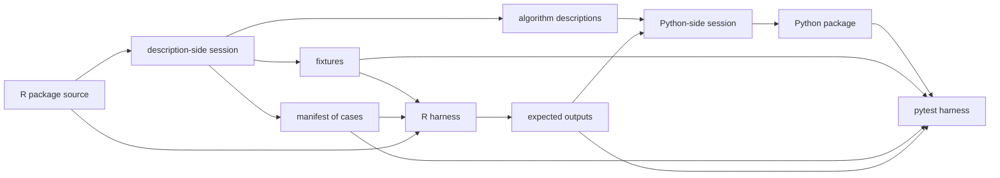
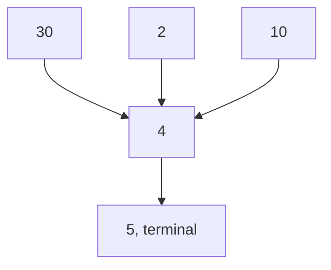
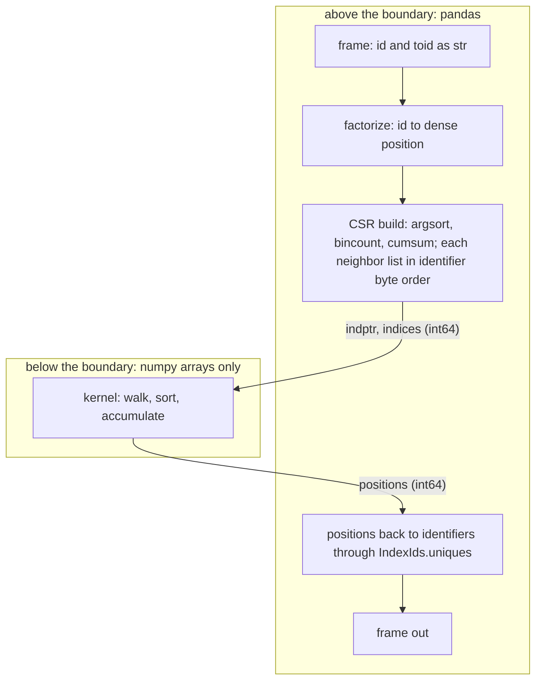
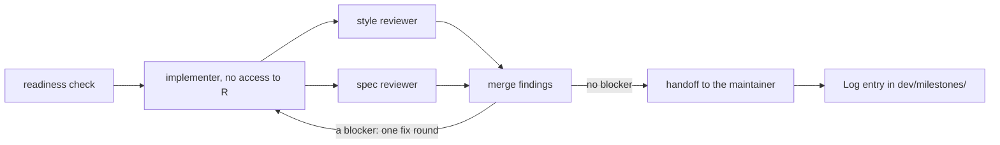

# Fixture architecture of the hydroloom Python port

hydroloom is an R package for working with hydrologic geospatial fabrics, or hydrofabrics: the tables of river flowlines and catchments, and the connections between them, that describe how water moves across the land surface. It provides general hydrologic network functionality for any hydrographic or hydrologic data, such as ordering a network from its headwaters to its outlet, walking it upstream or downstream, and adding the attributes a model reads. A Python package with the same functions is being written beside it, in the same repository.

The two packages share no code. What they share is a set of files under `inst/extdata/conformance/`: small test networks called fixtures, a written description of each function, and the outputs the R package produces for every fixture. A Python function is accepted when it reproduces those outputs, case by case. This document explains that arrangement from the fixtures outward: what they are, how one becomes an expected output, how it constrains the lowest layer of the Python code, and how AI agent sessions were used to build it while keeping the Python independent of the R source.

At the time of writing (November 2026), the R side of the arrangement is in place for the first 15 functions, with 452 cases on 158 fixtures. No Python function has been written yet. Everything below describes the contract the Python will be written against.

| If you are | Start with |
| --- | --- |
| a Python developer who may write or review a ported function | [From fixture to kernel](#from-fixture-to-kernel), then [What binds the Python](#what-binds-the-python) |
| reading about how AI agents were used to port an existing package | [Two sessions and a record](#two-sessions-and-a-record) |
| a hydrologist checking the network conventions | [A river network as a table](#a-river-network-as-a-table), then [One case, end to end](#one-case-end-to-end) |

## The arrangement in one picture



The left half reads R. A description-side session (an AI agent session allowed to open the R source) writes each function's algorithm description, its fixtures, and its cases. The R harness then runs the R package on every case and writes the result as an expected output, a GeoPackage layer per case. Expected outputs are generated, never typed (SPEC S-7); R is the only generator until a function reaches parity.

The right half never reads R. A Python-side session writes the Python from the description and the expected outputs alone, and the pytest harness compares what the Python returns with what R returned. The planning documents call this two readings of one written definition (DESIGN §1). When the two implementations disagree and the definition is silent, the definition is what gets fixed.

## A river network as a table

hydroloom represents a network as a table with one row per flowline (a line that represents a segment of a flowing body of water). Two columns carry the connections: `id`, the flowline's identifier, and `toid`, the identifier of the flowline it flows into.

| id | toid |
| --- | --- |
| 1 | 3 |
| 2 | 3 |
| 3 | |

Flowlines 1 and 2 meet at a confluence and flow into 3. Flowline 3 is a terminal, the flowline where water leaves the network, identified by a rule rather than a value: a row whose `toid` is not present in the `id` column (SPEC I-4). The empty cell could as well be `0`, `-1`, or the identifier of a flowline outside the table. A headwater is a flowline with nothing upstream of it. Where a river splits, at a divergence, one downstream flowline is the main path and the others are minor paths; a table records that by repeating the `id` of the flowline above the split, one row per downstream flowline, or by carrying `fromnode` and `tonode` columns in place of `toid`. hydroloom calls each of these column patterns a representation, and each function's description says which ones it accepts.

Identifiers are opaque. NHDPlusV2 uses integers, 3DHP uses strings, and NHDPlus HR uses integers too large for 32 bits. Python reads every identifier as a string on ingest (SPEC I-2); R keeps a 32-bit integer where the values fit and a string otherwise. The harnesses compare identifiers as text, so R's integer `100` and Python's `"100"` are the same identifier. The reason for strings in Python is practical: pandas promotes an integer column with one missing value to float, and a `toid` that silently becomes float passes value comparisons and fails an equality join (DESIGN §7).

## Fixtures

A fixture fixes one decision about a network in a file small enough to check by hand. Each is a GeoPackage under `inst/extdata/conformance/fixtures/`, built by one script (`make_fixtures.R`) and listed in `fixtures/index.yaml` with its source, its row count, what it exercises, and the SPEC rules it exercises. Of the 158 fixtures, 131 have twelve rows or fewer and 145 carry no geometry, since topology needs only the table. The largest are real networks: the New Hope basin from NHDPlusV2 (746 flowlines, the network hydroloom already ships), a 3DHP extract of the same basin (2,710), and an NHDPlus HR subset (2,691).

The fixtures fall into a few families, each pinning a different kind of behavior.

| Family | What it pins | Examples |
| --- | --- | --- |
| boundary (SPEC S-6) | the one-flowline, no-connection, and zero-row paths | `single_flowline.gpkg`, `all_terminals.gpkg`, `empty_network.gpkg` |
| tie | an order the algorithm leaves open, decided by identifier | `sort_siblings.gpkg`, `dfs_tie.gpkg` |
| permuted twin | the same network in another row order, which must give the same answer (D-7) | `sort_siblings_permuted.gpkg`, `new_hope_shuffled.gpkg` |
| cycle | networks that drain back into themselves and must be detected (D-8) | `three_cycle.gpkg`, `reciprocal_pair.gpkg`, `self_loop.gpkg` |
| coding | divergence and outlet codings found in real sources, tolerated with a warning or refused | `add_toids_divergence_zero_main.gpkg`, `outlet_foreign.gpkg` |
| real subset | a source's column names, identifier types, and scale | `new_hope.gpkg`, `new_hope_3dhp.gpkg`, `nhdplushr.gpkg` |

A case is one call on one fixture. The manifest, `inst/extdata/conformance/manifest.yaml`, lists 452 of them across the 15 functions: 375 compare a returned value, 70 expect an error, and 7 expect a warning. Its entries are short:

```yaml
- id: sort_network_siblings
  function: sort_network
  fixture: sort_siblings.gpkg
  args: {}
  compare: exact
  order: exact
  supported_by: [r]
  generator: [r]
```

The `id` is the layer name in `expected/sort_network.gpkg` and will be the pytest test id. `order: exact` says row order is part of the answer. `supported_by` and `generator` say which languages pass the case and which writes its expectation; the parity table in `conformance/parity.md` is generated from them.

## One case, end to end

`sort_network` orders a network so that reading it from top to bottom goes from upstream to downstream. Its worked example is `sort_siblings.gpkg`, five rows stored in this order:

| id | toid |
| --- | --- |
| 30 | 4 |
| 2 | 4 |
| 10 | 4 |
| 4 | 5 |
| 5 | 0 |



Flowlines 30, 2, and 10 all flow into 4, so any order of the three that precedes 4 is a valid upstream-to-downstream order. Nothing in the network chooses among them. hydroloom 1.3.0 left the choice to input row order: this fixture gave 30, 2, 10, 4, 5, and its permuted twin, the same five rows stored as 5, 2, 4, 10, 30, gave 2, 10, 30, 4, 5. Two copies of one network gave two answers.

SPEC D-4 settles the tie by identifier byte order: the identifiers are compared as text, character by character, so `"10"` precedes `"2"` precedes `"30"`. Byte order works the same on every platform and for integer and string identifiers alike, with no locale setting (D-1). The R package was changed to that rule, with a NEWS entry, before any Python existed, and the expected layer for both fixtures is now:

| id | toid |
| --- | --- |
| 10 | 4 |
| 2 | 4 |
| 30 | 4 |
| 4 | 5 |
| 5 | 0 |

A third fixture, `sort_siblings_text.gpkg`, carries the string identifiers `B`, `_c`, `a`, and `b`, whose byte order differs from the alphabetical order a locale-aware sort gives. Python's default string comparison is code-point order, which agrees with byte order.

For a hydrologist, the order is the one NHDPlus encodes in hydrologic sequence (`Hydroseq`): sorting a dendritic NHDPlus table by descending `Hydroseq` also puts every flowline after everything upstream of it. The two share that partial order and break ties differently, so they need not agree row for row.

The fixture says nothing about how the sort is written. A Python `sort_network` that walks the network with a stack and one that computes depths and sorts on them pass equally, provided each gives this order here and on the other 68 `sort_network` cases.

## From fixture to kernel

The Python package is designed with every graph computation below one boundary (SPEC K-1). Above it are pandas frames, identifiers, the vocabulary of column names, checks, and errors. Below it are numpy arrays and nothing else: a compressed sparse row (CSR) adjacency in `indptr` and `indices`, attribute arrays, and scalars. Code below the boundary is called a kernel. A kernel never looks up an identifier, reads a column name, or raises a domain error (K-5), and its index arrays hold dense `int64` positions from 0 to n − 1, never identifier values (K-6). An import-linter contract will hold `hydroloom._kernels` to importing neither pandas, geopandas, nor shapely (K-9).



That boundary creates a tension the fixtures resolve. Every tie rule is stated on identifiers, and no kernel can see an identifier. SPEC D-5 closes the gap at the one place both meet: `make_index_ids` builds the CSR so that every flowline's neighbor list is in identifier byte order. A kernel that visits neighbors in array order then inherits the canonical order without knowing it exists.

The worked example for `make_index_ids` shows the arrays. Three headwaters, 30, 4, and 100, flow into 10, which flows into the terminal 7. With positions assigned in order of first appearance, as `pandas.factorize` does, the upstream (`"from"`) index is:

```text
uniques = ["30", "4", "100", "10", "7"]   # dense position -> identifier
indptr  = [0, 0, 0, 0, 3, 4]              # neighbors of i are indices[indptr[i]:indptr[i+1]]
indices = [2, 0, 1, 3]                    # 10 <- "100", "30", "4";  7 <- "10"
```

Numeric order would list 10's upstream flowlines as 4, 30, 100, and hydroloom 1.3.0 listed them in input row order. The expected output does not store `indptr` or `indices`, since dense positions are the implementation's choice. It stores a long table with one row per connection, and `position` records the order within each list:

| id | position | neighbor |
| --- | --- | --- |
| 10 | 0 | 100 |
| 10 | 1 | 30 |
| 10 | 2 | 4 |
| 7 | 0 | 10 |

The same reading applies across the boundary fixtures and tie fixtures. Each one forces something on the arrays or the walk, whatever the code looks like.

| Fixture | What it forces below the boundary |
| --- | --- |
| `single_flowline.gpkg` | an `indptr` of length 2 and a one-flowline walk, with no special case for n = 1 |
| `all_terminals.gpkg` | five empty neighbor ranges; a terminal is an empty range, and CSR carries no sentinel value (K-4) |
| `empty_network.gpkg` | zero-length arrays in, and zero rows out with every computed column present and typed (I-11) |
| `make_index_ids_worked_example.gpkg` | each neighbor list in identifier byte order (D-5) |
| `sort_siblings.gpkg` and its twin | siblings in identifier byte order in the output, whatever the input row order (D-4, D-7) |
| `dfs_tie.gpkg` and its twin | depth-first visit order with the smallest identifier first, and where one path of the walk ends and the next begins (D-6) |
| `three_cycle.gpkg`, `reciprocal_pair.gpkg`, `self_loop.gpkg` | cycle detection by strongly connected components: any group of flowlines that drain into each other, including a flowline whose `toid` is its own `id` (D-8) |

The cycle fixtures show how much freedom is left. SPEC D-8 gives the Python check as `scipy.sparse.csgraph.connected_components(connection="strong")`; in R it is a Tarjan walk in base R. Neither implementation resembles the other, and both are held to the same fixtures. The one phase-1 exception is the depth-first walk under `navigate_network_dfs`, a named kernel whose signature binds both languages, `dfs_paths(indptr, indices, starts, main, reset) -> (visit, path, start_ptr)` (K-6), because it is a candidate for a compiled core the two packages would share (DESIGN §4). Every other kernel's shape is the Python author's.

Fixtures also grow from the Python side. A hypothesis property runs on every manifest function and every fixture: shuffle the rows, run the function, and compare with the unshuffled result (D-7). Other properties come from each description's Postconditions. When hypothesis finds a failure, the small network it shrinks to becomes a new synthetic fixture and a manifest case, and the tolerance is never loosened to admit it (VERIFICATION §4).

## What binds the Python

Each function has an algorithm description at `inst/extdata/conformance/algorithms/<function>.md`, in one fixed shape that a validator checks (SPEC S-8). The Python-side session reads it as a contract, and only some of its sections bind.

| Section | Binds the Python | Holds |
| --- | --- | --- |
| Signature | yes | function and argument names, types, return columns, and a named kernel's signature |
| Preconditions | yes | the representation and columns required, and the error raised without them |
| Definition | no | the output stated as a property of the input |
| Algorithm | tie rules and sentinels only | the steps, which the Python may reorder or replace |
| Postconditions | yes | invariants, each one a hypothesis property |
| Edge cases, Remedies, Worked example | through the cases | behavior at the boundaries in plain words, error conditions keyed to `remedies.json`, one fixture worked by hand |

The harnesses compare by rules both languages share, so a difference in dtype or float rounding between R and pandas does not read as a difference in behavior.

| What | How it is compared | Rule |
| --- | --- | --- |
| identifiers | as text | SPEC S-7, I-1 |
| other columns | coerced to the dtype the vocabulary type declares, then `pandas.testing.assert_frame_equal(check_dtype=True)` | S-7 |
| lengths and areas | within 1 m or 1 m², with no relative tolerance, since hydrographic coordinates are good to about a meter | D-13 |
| row order | only where the case says `order: exact` | D-14 |
| columns | by name, never by position | D-14 |
| errors and warnings | by the `remedies.json` key the case gives in `raises_key` | A-10 |

Every phase-1 case compares with no tolerance, because none of the first 15 functions computes a floating-point value. The length and area rules arrive with path length and drainage area in later phases.

## Two sessions and a record

Most of the R-side work so far was done by AI agent sessions directed by one maintainer. An agent session, in this project, is a large language model working through one task with a fixed set of tools: it reads files, runs commands such as the test suite, and writes files, within the permissions its configuration grants. A session starts with no memory of earlier sessions; what it knows of the repository is what it is given and what it reads. Each agent's instructions and permissions are files under `.kiro/agents/` (Kiro is the agent tool the project uses), and each multi-step procedure is a workflow file under `.kiro/workflows/`.

The port is split between two kinds of session, and the split is why the fixtures carry so much weight. A description-side session may read `R/`. It writes a function's description, fixtures, and cases, and any change to the R package the plan calls for. A Python-side session never opens `R/` or the R tests, because the implementer's permission file denies both, and it cannot write under `inst/extdata/`. It writes the Python from the description, the SPEC rules the description cites, and the expected outputs. Software teams have long used this clean-room method to reimplement a system without copying it: one group reads the original and writes a specification, and a second group, which never sees the original, builds from the specification alone.

The reason for the split is in DESIGN §1. A session that has read the R body writes a transliteration, with R's loop structure and R's names, that Python users do not recognize as Python. A session that has only the definition writes Python, and where the definition is silent, the silence surfaces as a question. The implementer lists each such question under "Description silent on" in the pull request body it writes for review, and those lines reach the maintainer as candidate edits to the description. The second reading is how a description's gaps are found.

The isolation has a limit. A permission file controls what a session reads; it cannot remove what a language model may have seen of hydroloom's public R source in its training data. The isolation shapes how the Python is written, and the conformance suite, which the Python-side session has no permission to edit, is what checks the result.

Reviews are separate sessions too. Before any Python is written, a hydrology reader (a session instructed to read as a river scientist and to cite NHDPlus and hydrofabric sources for each finding) reads each description and its fixtures, because a wrong sentence is cheapest to fix before an implementer reads it. Each Python function then goes through one workflow:



The readiness check confirms that the description passes its validator, every case is in the manifest, and the last R conformance run was green. The two reviewers work in parallel, each from the diff and its own reading list, without the other's findings or the implementer's transcript. The style reviewer asks whether a pandas or geopandas maintainer would merge the code as written, and the workflow runs it on a model from a different provider than the implementer's. The spec reviewer reads the description before the code and checks one against the other. Every finding cites an anchor (a SPEC rule, a description section, a checklist item, or a source document), and a finding with no anchor is recorded but cannot block.

Agents do not type expected values, make decisions, or write the prose users read. Expected values come from running the R package, so an agent can build a wrong fixture but cannot type the answer to one; an answer changes only through a change to the R package that ROADMAP §4 lists in advance and a NEWS entry records. Every finding lands in the milestone's Log (`dev/milestones/M<n>.md`) with a disposition column the maintainer fills; an agent writes a cell only where an earlier disposition, a ROADMAP §4 row, or a principle in `dev/plan/RULES.md` already decides it. The README, articles, vocabulary definitions, and error messages are the maintainer's, and agents review them. Every agent commit carries an `Assisted-by:` trailer, and each Log entry records the base and head commits of the diff its reviewers read, so any review can be reproduced with `git diff`.

In the third milestone this meant description-side sessions writing the 15 descriptions and 452 cases, a hydrology reader reading all 15 descriptions five times across the milestone's runs, and the maintainer deciding the 218 numbered items in that milestone's decision table. Those decisions were then written down as the principles in `RULES.md`, so a later session applies them by citation rather than asking again.

## Where things stand

| Milestone | What it produces | State |
| --- | --- | --- |
| M1 | the vocabulary of column names as JSON both packages read | done |
| M2 | the manifest, the fixtures, and the R harness | done |
| M3 | 15 descriptions, 452 cases, and the R changes they called for | closed 2026-10-29 |
| M3-5 | this document | in review |
| M4 | the Python skeleton, the pytest harness, and the CSR kernel | next |
| M5 | the first Python functions and the first release, py-v0.1.0 | |
| M6 | the remaining functions in dependency order | |
| M7 | documentation with R and Python code tabs | |

## Where to look

```text
hydroloom/
├── R/                          R package source; the description side only
├── tests/testthat/             R tests and the R conformance harness
├── src/hydroloom/              Python package (from M4)
│   └── _kernels/               arrays in, arrays out
├── tests/python/               pytest and the Python conformance harness (from M4)
├── inst/extdata/
│   ├── hy_vocab.json           column names and types both packages read
│   ├── remedies.json           the catalog of error text, by key
│   └── conformance/
│       ├── algorithms/         one description per function
│       ├── fixtures/           the networks, with index.yaml
│       ├── expected/           one GeoPackage per function, one layer per case
│       ├── manifest.yaml       every case
│       └── parity.md           which functions each language supports
├── dev/plan/                   SPEC, DESIGN, VERIFICATION, ROADMAP, RULES
├── dev/milestones/             the review record, one file per milestone
└── .kiro/                      agent instructions, permissions, workflows
```

The rules cited above by anchor (K-1, D-4, S-7) are in `dev/plan/SPEC.md`, the reasoning behind them under the same headings in `dev/plan/DESIGN.md`, and the harness and test gates in `dev/plan/VERIFICATION.md`.
