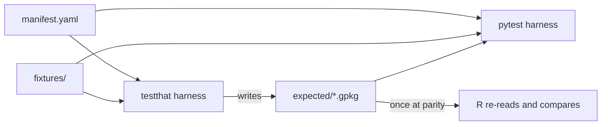

# hydroloom Python port — VERIFICATION

How the repository is laid out, built, tested, and released, and what has to be true before a step is done. Behavior rules are in SPEC.md and are cited by anchor; reasoning is in DESIGN.md.

Sections: 1 layout, environments, dependencies · 2 conformance harness · 3 CI · 4 property, doctest, and interface tests · 5 scale, benchmark, downstream, end to end · 6 documentation checks and tooling defaults · 7 release pipeline.

## 1. Layout, environments, dependencies

### 1.1 Tree

One repository, one root, both packages interleaved. The R package stays where it is; the Python package is overlaid; each toolchain sees only what its include rules admit (1.2, 1.3).

| Path | Belongs to | Contents |
| --- | --- | --- |
| `DESCRIPTION`, `NAMESPACE`, `R/`, `man/`, `vignettes/`, `tests/testthat/`, `NEWS.md` | R | the R package, unchanged |
| `inst/extdata/hy_vocab.json`, `inst/extdata/abbreviations.json` | shared | the one copy of the vocabulary and abbreviation table (SPEC S-1) |
| `inst/extdata/remedies.json` | shared | the authored message catalog (S-1, A-10); force-included in the wheel |
| `inst/extdata/docstrings.json` | shared, derived | generated from `man/` by the `dev/` script (A-13); committed, CI-diffed, force-included |
| `inst/extdata/conformance/` | shared | `fixtures/`, `expected/`, `manifest.yaml`, `algorithms/` (S-1); Rbuildignored |
| `dev/plan/` | shared | SPEC, ROADMAP, VERIFICATION, DESIGN; Rbuildignored under `^dev$` |
| `dev/milestones/M<n>.md` | shared | the review record, one file per milestone, created with its branch; the disposition column is the maintainer's; Rbuildignored under `^dev$` |
| `dev/` scripts | R | the `docstrings.json` generator; Rbuildignored |
| `src/hydroloom/`, `src/hydroloom/CLAUDE.md` | Python | the package, standard src layout (K-9); the agent notes for the package tree |
| `tests/python/`, `tests/python/CLAUDE.md` | Python | pytest and the conformance harness; the agent notes for the test tree |
| `AGENTS.md`, `.kiro/` | shared | rules for every agent; Kiro agents, workflows, steering, context; `.kiro/workflow-output/` gitignored |
| `.github/PULL_REQUEST_TEMPLATE.md` | shared | one line: the body is the milestone file's Summary section |
| `benchmarks/` | Python | asv; `results/` committed |
| `pyproject.toml`, `pixi.lock` | Python | package metadata and the pixi workspace (1.5) |
| `CHANGELOG.md`, `changelog.d/` | Python | changelog and towncrier fragments (1.7) |
| `README.md`, `LICENSE.md`, `CITATION.cff` | shared | one of each, referenced from both manifests |
| `.pre-commit-config.yaml` | shared | one config for both languages |
| `.github/workflows/` | shared | development CI on the GitHub mirror (§3) |
| `.gitlab-ci.yml` | shared | release jobs on code.usgs.gov (§7) |

`docs/`: pkgdown keeps it. Quarto articles build under pkgdown from `vignettes/articles/`. The Python reference (quartodoc) builds to a `python/` path under the same site.

### 1.2 `.Rbuildignore` additions

When a Rust core lands, `^src$` narrows to `^src/hydroloom$` and nothing else moves. Already present in the checkout and not repeated here: `CLAUDE.md`, `.claude`, `^\.github$`, `^dev$`, `data-raw`, `.gitlab-ci.yml`, `^AGENTS\.md$`, `^\.kiro$`.

```
^src$
^tests/python$
^benchmarks$
^\.asv$
^inst/extdata/conformance$
^pyproject\.toml$
^pixi\.lock$
^\.pixi$
^CHANGELOG\.md$
^changelog\.d$
^CITATION\.cff$
^\.pre-commit-config\.yaml$
^\.ruff_cache$
^\.pytest_cache$
^\.hypothesis$
```

### 1.3 hatchling

Wheel: `packages = ["src/hydroloom"]`. Sdist: a positive `only-include` list, never an exclude list:

```
src/
tests/python/
inst/extdata/
pyproject.toml
README.md
LICENSE.md
CHANGELOG.md
CITATION.cff
```

`hy_vocab.json`, `abbreviations.json`, `remedies.json`, and `docstrings.json` reach `hydroloom/data/` by `force-include` at build time and `force_include_editable` for editable installs (a `hatch_build.py` hook if the plain option does not apply); the pixi `install` task reinstalls editable so a JSON edit is picked up. The package reads them through `importlib.resources.files("hydroloom.data")`, never a path built from `__file__`. The conformance directory is in the sdist so conda-forge runs conformance in its test section.

### 1.4 Ignore and attribute files

`.gitignore` is shared and gains:

```
.pixi/
__pycache__/
*.egg-info/
dist/
```

`.gitattributes`: `*.gpkg` binary; `eol=lf` on text fixtures, so a Windows checkout cannot alter an expectation.

### 1.5 Environments and tasks

`pyproject.toml` holds `[project]` and `[tool.pixi.*]`. No `environment.yml`, `requirements.txt`, `setup.py`, `pixi.toml`, or `renv.lock`. pixi is developer-side only; users install with pip or conda. Tasks are the only entry points; CI calls the same tasks against the same lockfile, except the two pip-based jobs in §3 whose point is to run outside it.

| Environment | Contents | Tasks |
| --- | --- | --- |
| `default` | the Python package and its runtime dependencies | `test`, `lint`, `build`, `install` |
| `r` | r-base, hydroloom's Imports and Suggests from conda-forge, one pinned GEOS | `r-check` (tarball `R CMD check --as-cran`, then `devtools::test()` from the checkout, which is where R conformance runs) |
| `r-floors` | as `r`, pinned to the `DESCRIPTION` version floors | `r-check` at the floors (SPEC D-2) |
| `docs` | both, plus reticulate, quarto, pkgdown, quartodoc, the Python package editable, the same pinned GEOS | `docs` |
| `py310`, `py313` | the Python version matrix | `test` |

Platforms: `linux-64`, `osx-64`, `osx-arm64`, `win-64`; conda-forge the only channel. `r` and `docs` run on Linux only in CI. Known costs: `.pixi/` is large and gitignored; `pixi.lock` diffs are noisy; a PyPI-only package needs `pixi add --pypi`.

### 1.6 Dependencies

Runtime, nothing else; pyproj arrives transitively. A floor moves only when a required dependency drops the version, never on the calendar. No upper bounds; §3's `py-upstream` job catches breakage instead.

```
python    >= 3.10
pandas    >= 2.2.2   (2.2.2 is the first release generally compatible with numpy 2; 2.2.0 and 2.2.1 are not)
numpy
scipy
shapely   >= 2.0
geopandas >= 1.0
pyogrio
```

Extras reserved by name, none built first:

```
graph    networkx and rustworkx conversion targets
dask     dask-geopandas
numba    not used in v1 (SPEC K-7); name held
schema   pandera
units    pint; never imported by the package (G-3)
```

Excluded, as the dependency-level statement of scope:

```
aiohttp
async-retriever
pygeoogc
pygeoutils
requests
xarray
rasterio
```

Code written to the floor: copy-on-write-clean pandas; no 3.11-only syntax (`Self`, exception groups; `match` is fine). R side: every Import in `DESCRIPTION` carries the oldest version the code runs on, found by testing in the `r-floors` environment; `dplyr (>= 1.1.0)` and `sf (>= 1.0-0)` are the two that change behavior (SPEC D-1, G-4).

Development and test dependencies, declared as pixi features and as a `dev` group so `pip install -e .[dev]` works without pixi, each arriving with the milestone that first needs it (ROADMAP):

```
hypothesis       property tests on kernels and fixtures (§4)
import-linter    the _kernels contract (§4)
pooch            the basin-scale fixture (§5)
jsonschema       manifest and vocabulary schemas (§2)
towncrier        changelog fragments (1.7)
hatch-vcs        version from the tag (1.7)
numpydoc         docstring validation hook
asv              benchmarks (§5)
pytest-cov       coverage, reported not gated (§3)
```

### 1.7 Version and changelog mechanics

- Version from the `py-v*` tag by hatch-vcs, with `tag_regex` and `git_describe_command --match "py-v*"` under `[tool.hatch.version.raw-options]` so an R `v*` or a `suite-v*` tag is never read; `__version__` via `importlib.metadata`; no version-bump commit.
- `license = "CC0-1.0"` (PEP 639). `CITATION.cff` at root pointing at the USGS software DOI. `py.typed` marker.
- Python changelog assembled by `towncrier build` from `changelog.d/` fragments typed added, changed, deprecated, removed, fixed; nothing edits `CHANGELOG.md` by hand.
- Tags `v*` (R, as today: `v1.2.2`), `py-v*`, `suite-v*`; each workflow triggers only on its own prefix, and hatch-vcs's `--match "py-v*"` keeps it from reading an R tag.

## 2. Conformance harness

Two kinds of tests, kept apart. Conformance tests check semantics and are driven by the manifest; both harnesses are thin, on the order of a hundred lines, and iterate it. Unit tests check interfaces (argument validation, error classes, dtype handling on ingest) and are language-local. An expectation about a computed value lives in the manifest, never inline (SPEC S-7).



- The R harness writes expectations when `HYDROLOOM_WRITE_EXPECTED=1` and compares otherwise. Regeneration is a deliberate act that shows as a changed GeoPackage in the pull request, with the value diff printed in the CI log. The Python harness compares, and writes only for a function whose manifest entry names Python as co-generator (S-7), under the same variable.
- Each harness has one converter per `returns` kind (S-4, S-7: frame, graph, traversal, scalar), checked by round trip; long-table returns are sorted on the manifest `key` before comparison.
- Per-function readiness, the gate before any Python is written: the description passes the template validator; every case is in the manifest with `fixture`, `expected`, `compare`, `order`, `supported_by`, and `generator`; `expected/<function>.gpkg` has a layer per case; the last R conformance run on the function is green. The spec reviewer checks it (`.kiro/agents/hl-spec-reviewer.md`, moment `readiness`).
- Comparison primitives: `pandas.testing.assert_frame_equal` and `geopandas.testing.assert_geodataframe_equal` with `check_dtype=True`, after coercing each column to the dtype the vocabulary type declares for that language (S-7), identifier columns compared as text (S-7, I-1), with `atol` per type and `rtol = 0` (D-13), row order compared only where the manifest says `order: exact` (D-14).
- The manifest, the vocabulary, and the abbreviation file each have a JSON Schema validated in pre-commit and CI; the description template's headings are checked the same way (S-8).
- The R harness locates the conformance directory with `testthat::test_path()` and `skip_if_not(dir.exists(...))`; the tarball check skips it; the tests that ship to CRAN are minimal interface tests, the collation test (D-1), and the vocabulary schema test.
- The existing R test suite is not ported. testthat tests that assert computed values migrate into manifest cases; the ones that remain are interface tests and stay in R.

### 2.1 Fixtures

GeoPackage throughout, one file per fixture; attribute-only fixtures are aspatial tables. Geometry fixtures stored projected in EPSG:5070; each under a megabyte. Expected outputs are one GeoPackage per function with a layer per case.

Real subsets, one per source, which is what exercises the vocabulary's `aliases`:

| Fixture | Source | Exercises |
| --- | --- | --- |
| New Hope | NHDPlusV2 | the default network; already shipped by hydroloom and hydrogeofetch; PR-scale runs of the scale harness and the pipeline test |
| NHDPlus HR subset | NHDPlus HR | identifiers outside 32-bit range: `character` in R by I-2, `str` in Python like every identifier; the HU04 0204 scale fixture (ROADMAP §3, closed 2026-10-25) |
| 3DHP subset | 3DHP | string identifiers; the `3dhp` alias set |
| reference hydrofabric subset | reference hydrofabric | the `hydrofabric` alias set |

Synthetic networks, a dozen flowlines each, for topology edges no real subset reliably contains:

| Fixture | Exercises | Rule |
| --- | --- | --- |
| divergence with a `divergence` attribute | source attribute wins | D-9 |
| divergence without one | the codified rule sequence and the byte-order fallthrough | D-9 |
| return divergence | `add_return_divergence` | |
| coastal terminal beside an inland one | `coastal_outlet_ids` / `inland_outlet_ids` in `add_divergence` | |
| isolated flowline | a node with no edges inside a larger network | |
| exact point-indexing tie from integer coordinates | tree order and identifier order disagree | D-10, G-7 |
| reciprocal pair | a two-flowline cycle, labeled `reciprocal` | D-8 |
| three-flowline cycle | a cycle the old pairwise test could not see | D-8 |
| self-loop (`toid == id`) | a size-one component with a self-edge | D-8 |
| one network duplicated in a feet-based state plane zone | exact-factor unit conversion against the EPSG:5070 copy | G-4 |

Boundary fixtures with decided behavior: SPEC S-6. The basin-scale fixture: §5.

## 3. CI

All jobs are path-filtered so an R-only change does not run pytest and vice versa; anything touching `inst/extdata/conformance/` or the vocabulary runs both. Because path filtering and required status checks conflict, every workflow starts and a first step decides whether to do the work or report success.

| Job | Trigger | Environment | Purpose |
| --- | --- | --- | --- |
| `r-check` | push, PR touching R paths | pixi `r`, Linux | `R CMD check --as-cran`, conformance from the checkout |
| `r-floors` | PR touching `DESCRIPTION` or R paths | pixi `r-floors`, Linux | the R version floors are honest |
| `py-test` | push, PR touching Python paths | pixi `py310`, `py313`; Linux, macOS, Windows | pytest with conformance, ruff, mypy, import-linter |
| `py-min-versions` | PR | pip, lowest declared versions of pandas, shapely, geopandas | the `[project]` floors are honest |
| `py-upstream` | weekly | pip, unpinned latest, plus nightly wheels from the scientific-python index for numpy, pandas, scipy | catches upstream churn before users do; red job and the default email are the signal, nothing opens issues |
| `conformance-parity` | PR touching conformance or the vocabulary | pixi `docs`, Linux | both harnesses against the same manifest; for co-generator functions, both write expectations equal in value and dtype; asserts both packages' code-declared `requires` tables equal the manifest's (A-4) |
| `docstrings-diff` | PR touching `man/`, `R/`, or `inst/extdata/docstrings.json` | pixi `r`, Linux | regenerates `docstrings.json` with the `dev/` script and fails on a diff (A-13) |
| `downstream` | weekly, gated on adoption | pip | pynhd and gdptools test suites against a wheel built from `main` (§5) |
| `docs` | push to main | pixi `docs`, Linux | pkgdown with Quarto articles, quartodoc; deploys |

Coverage: covr and pytest-cov, per language, reported and not gated.

Repository configuration: one `.pre-commit-config.yaml` with ruff (lint and format), the R `precommit` hooks for styler and lintr (run in CI only, so a contributor without R can commit), codespell, and the schema validators; Renovate, not Dependabot, because Renovate reads `pixi.lock`, limited to GitHub Actions and a weekly grouped lock refresh; GitHub Actions pinned by commit SHA.

## 4. Property, doctest, and interface tests

- hypothesis on the kernels from M4 (`_kernels/csr.py` first): random directed acyclic graphs with asserted invariants (a valid topological order, unique level path identifiers, path length monotone downstream, `sort_network` idempotent), each public function's properties taken from its description's Postconditions, and over the conformance fixtures the master property, permutation invariance of every manifest function (SPEC D-7).
- `numpydoc.validate` runs on the imported public objects inside a pytest test (A-13), since docstrings are composed at import and a static hook cannot see them. Run with `derandomize=True` in the CI profile so a failure reproduces from its printed seed; the `.hypothesis/examples` database is committed so a found failure is a permanent regression test. Rule: a property violation is a conformance case not yet written; the minimal failing graph hypothesis shrinks to becomes a synthetic fixture and a manifest case.
- Doctests run with `--doctest-modules`; every docstring example runs.
- `tests/python/test_api.py` asserts `hydroloom.__all__` equals the set of functions the manifest lists (A-18).
- import-linter contract: `hydroloom._kernels` imports neither pandas, geopandas, shapely, nor `hydroloom._hy` (K-9); runs as a lint step beside ruff and mypy.
- mypy strict on `_kernels` and `index_ids.py`, with kernel signatures `NDArray[np.int64]` and `NDArray[np.float64]`; standard elsewhere; no `pandas-stubs` (A-14).

## 5. Scale, benchmark, downstream, end to end

The conformance suite tests one function per case on fixtures small enough to commit. Four checks sit outside it.

**Scale harness.** One code path with one switch, `HYDROLOOM_SCALE_FIXTURE`. Unset, it runs against New Hope in pull-request CI on every commit, so the comparison machinery never rots. Set to the fixture's pooch key, it runs against HU04 0204, the Delaware: a coastal basin with divergences, chosen because 3DHP has no coastal coverage (which NHDPlus product supplies it is ROADMAP §3), fetched by pooch from a release asset on the GitHub mirror tagged `fixtures-v1` and hash-pinned in the registry, never in the repository. It runs each ported function in R and Python on the same network and compares in memory with the §2 primitives, committing no expectations. The same switch gates the hypothesis invariants as plain assertions on whichever network it was given. It writes one JSON evidence file under `benchmarks/results/scale/`: per function and column, the maximum absolute difference and rows compared; wall time per language; GEOS, pandas, sf, and data.table versions; fixture name and commit.

**Benchmarks.** asv under `benchmarks/`, timing and `peakmem`, on the same 0204 network, compared against the previous release tag on the same developer machine. Results committed under `benchmarks/results/`. A regression past 1.5× is explained in the release notes, not gated. This is the instrument for every compiled-kernel decision (SPEC K-7), so it exists before the first such decision.

**Downstream.** The weekly `downstream` job in §3, meaningful once pynhd or gdptools depends on the package; written with the others, gated on adoption.

**End to end.** One pipeline test per language on the chain raw subset → `align_names` → `add_toids` → `sort_network` → `add_levelpaths` → point indexing, comparing final outputs with the §2 primitives. It is the code of the pipeline article (ROADMAP M7), so the first page on the site and the end-to-end test are one thing. It lives in each language's own suite, not the manifest, so `args` stay literal, and it runs on the same switch as the scale harness.

**Cadence.** `pixi run scale` and `pixi run bench` run at three moments: before a release, when a compiled-kernel decision is being made, and after any change to a kernel. Neither runs in pull-request CI against the domain. The release pipeline refuses a tag whose `benchmarks/results/scale/` entry does not name that tag's commit (§7).

**WBD dissolve benchmark**, run once before the `dissolve_polygons` implementation is chosen (ROADMAP M6). Inputs: Watershed Boundary Dataset HUC12 polygons for several HUC2 regions, dissolved to HUC8 and HUC4. Compared: `union_all`, `coverage_union_all`, and `GeoDataFrame.dissolve` in Python against `sf::st_union` and the `geos` path in R, on wall time, validity of the result, and hole and gap counts before and after the fill steps. The same inputs exercise `check_valid` on the `GEOMETRYCOLLECTION` case. The result is a benchmark note under `benchmarks/`, not a test.

## 6. Documentation checks and tooling defaults

Rules that keep the two-language documentation honest:

- Every code tab runs at build time in the `docs` environment. No pasted output.
- A demo reads its data from `inst/extdata/conformance/fixtures/` where a fixture serves, so demos and tests share inputs.
- Prose refers to functions by the shared snake_case name; language-specific syntax appears only inside tabs.
- An article without a Python tab says so in one line rather than showing an empty tab.
- Roxygen is the authored source for both; the Python docstring is composed at import from `docstrings.json` (SPEC A-13), so the hydrology is written once.
- Prose follows `.kiro/context/prose.md` (AGENTS.md rule 9): existing text is reused; agents author prose only in changelog fragments, doctests, and PR bodies; the A-13 substitution table is reviewed once as its own Log item; `plain` fields and `remedies.json` go to the two readers in the milestone that writes them, not at M7.

Tooling defaults, each cheap to reverse:

```
quartodoc        Python API reference; `dynamic: true` so import-time docstrings are read; one Quarto toolchain beside pkgdown; costs intersphinx links
ruff             rule families PD NPY B UP I D with the numpydoc convention; PD901 on; PD010/PD013 on until one fires on real code; D417 exempted for decorated functions
mypy             strict on _kernels and index_ids.py only; no pandas-stubs
numba            only in its own pixi feature, never in default
pixi platforms   linux-64, osx-64, osx-arm64, win-64; conda-forge only
Renovate         GitHub Actions plus a weekly grouped pixi.lock refresh
towncrier types  keep-a-changelog: added, changed, deprecated, removed, fixed
R pre-commit     styler and lintr hooks run in CI only
logging          none
```

## 7. Release pipeline

Publisher of record is code.usgs.gov for R and Python alike. Development CI stays on the GitHub mirror; only release jobs live in `.gitlab-ci.yml`. Both releases are two-stage and branch-then-tag, as the R package already does: a hand-pushed `rc/` branch runs the pipeline and produces the artifact; the tag is created on GitHub after the registry accepts it and pushed to code.usgs.gov by hand. Invariant: the tag on both mirrors names one commit, and the wheel is built on code.usgs.gov, never from a working tree and never from the mirror.

| Package | Stage 1 trigger | Stage 1 | Stage 2 trigger | Stage 2 | Registry |
| --- | --- | --- | --- | --- | --- |
| R | `rc/<version>` branch on code.usgs.gov | `R CMD check --as-cran`; `R CMD build`; verified source tarball to the GitLab package registry; manual CRAN submission from that tarball | tag after CRAN acceptance | none (the tag marks the commit) | CRAN; r-universe builds automatically |
| Python | `rc/py-<version>` branch on code.usgs.gov | `python -m build` (hatch-vcs yields a `.devN` version, the right thing to rehearse with); install the wheel into a clean environment and run conformance against it; `twine check`; `check-wheel-contents`; upload to TestPyPI | `py-v<version>` tag on the same commit, pushed to code.usgs.gov (`$CI_COMMIT_TAG =~ /^py-v/` in the workflow rules) | the same steps, upload to PyPI; the conda-forge bot opens the feedstock PR | TestPyPI, then PyPI, then conda-forge |
| Suite | `suite-v*` tag, or bumped inside an R or Python release | none; the tag marks the manifest version both packages pin | | | repository only |

Runner and credentials, copied from the R pipeline where proven: the `chs-shared` runner; images through the group dependency proxy (`condaforge/miniforge3` for Python, since pixi's image is on ghcr.io outside the proxy); the DOI root certificate stored as a file-type CI variable, not fetched with `wget --no-check-certificate`, and exported to pip and twine as `SSL_CERT_FILE` and `REQUESTS_CA_BUNDLE`; egress to `upload.pypi.org` and `test.pypi.org`, checked when the first release is prepared (2026-10-25: release setup is David's, done at M5, not before M4). Tokens: the 0.0.1 stub's first upload runs on a user-scoped PyPI token because a project-scoped token cannot exist before the project does; then a project-scoped token replaces it as a masked, protected variable and the user-scoped one is revoked. Protection takes effect only if `py-v*` is a protected tag pattern with the pushers on the allowed list. TestPyPI is a separate account and token. Tokens do not expire; rotation is a line in the release checklist at each minor release. Trusted publishing does not cover self-hosted GitLab.

Gates for a `py-v*` tag, phased: from 0.0.1, the wheel installed clean and passed conformance in the release job; from the first tag after M6, the scale and bench entries as well.

```
wheel installed clean and passed conformance in the release job
towncrier build assembled the changelog section
benchmarks/results/scale/ has an entry naming this commit     (pixi run scale; from the first tag after M6)
benchmarks/results/ has an asv entry for this tag             (pixi run bench; from the first tag after M6)
token rotated at a minor release
```

Branch rule: agents commit directly to `python-port`; there are no milestone branches. `python-port` merges to `main` with a merge commit (`gh pr merge --merge`), never squash, so the per-function commits and their `Assisted-by` trailers survive. Each milestone close includes the trailer check: `git log <milestone start>..HEAD --format='%h %an %(trailers:key=Assisted-by,valueonly)'` shows a trailer on every agent commit and no `Signed-off-by` or `Co-Authored-By` anywhere. The first stage-1 run is the 0.0.1 stub that claims the name (ROADMAP M4). conda-forge: one feedstock, `hydroloom`, generated once with grayskull from the sdist and maintained by bot PRs; `r-hydroloom` is a separate, optional feedstock by the usual R route.
